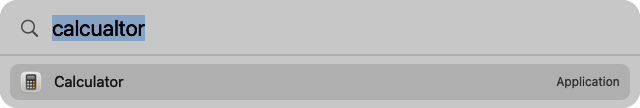

# Floodlight

Floodlight is a macOS launcher built to put the app, file, folder or settings page you typed at
the top, quickly and consistently, including when the name has a typo. It is a native Swift app
with no third-party dependencies: its own file discovery, in-memory index, typo-tolerant matching
and deterministic ranking, built to stay responsive while you type.



## Trying Floodlight

Requires macOS 14 or later and the Xcode command line tools.

```sh
scripts/build_floodlight.sh            # builds app/.build/Floodlight.app
open app/.build/Floodlight.app
```

Press **Control-Space** to open the search bar, type, use the arrow keys to pick a result, Enter
to open it and Escape to close. It searches installed apps, System Settings panes, and folders and
files in your home folder (not `~/Library`). macOS asks once for access to Desktop, Documents and
Downloads. If Control-Space is already your input-source shortcut, change one of them in
System Settings → Keyboard → Keyboard Shortcuts.

## How it works

Floodlight is a Swift 6 package (strict concurrency, AppKit, no dependencies) with two parts:
- `FloodlightCore`, the search library: discovery, index, matching, ranking and launching;
- the `Floodlight` app: the panel, the hotkey and the threading.

### Discovery

Floodlight reads the file system directly and does not use the Spotlight index.

| Source | Where it looks | Details |
|---|---|---|
| **Apps** | `/Applications`, `/System/Applications`, `/System/Library/CoreServices/Applications` and `~/Applications` | Includes apps inside vendor folders, but not apps nested in other apps. Symlinked duplicates are dropped. Each app's bundle names (for example "Chrome" for Google Chrome) become alternative names. |
| **Settings** | The 28 top-level System Settings panes | Each has a few search keywords ("battery" finds Energy) and opens through its `x-apple.systempreferences` URL. |
| **Files and folders** | The home folder | Skips hidden files, `~/Library`, package contents and dependency or cache folders such as `node_modules`. |

### Checks

- `core-selftest`: matching and ranking rules, for example "frecency can't beat an exact name".
- `perf-check`: search timing on the local index. It prints counts and timings only.

## Application Benchmark

This repository also contains a public benchmark comparing Floodlight with Spotlight and Raycast
inside a clean macOS virtual machine. The test rules, scoring and main comparison were fixed and
published before the runs, and the hidden test queries were committed to by a published hash.

**Results:**
- **Floodlight was meaningfully better than Spotlight on the main measure:** +19.8 points
  (likely range +18.7 to +20.9). Floodlight put the intended app first on 100% of the 209 main
  test queries, against 80.2% for Spotlight and 84.9% for Raycast.
- **Typos made the difference:** with one typo in the name, Floodlight still found the app every
  time. Spotlight almost never did (0–1.4%), and Raycast managed 23–28%. On correctly typed
  names, all three were essentially perfect.
- **Scope:** apps only, synthetic typos, one VM, no usage history.

[Full benchmark results](docs/heldout-results.md) ·
[Verifying the results](release/heldout-2026-11-18/README.md)
